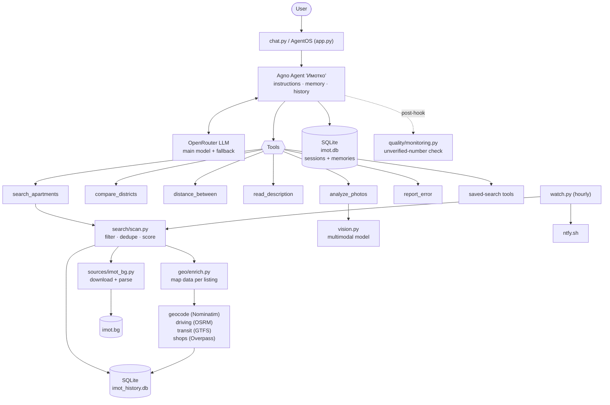

# Imotko

**An AI real-estate broker for [imot.bg](https://www.imot.bg).** You describe the apartment you want in plain Bulgarian; Imotko crawls the listings, filters and scores them, reads their descriptions and photos, measures distances and commute times, watches your search over time, and answers with a card per apartment, **using only data returned by its tools**.

> Imotko never invents listings. Every number in an answer must come from a tool, and an automatic check flags the ones that do not.

---

## Table of contents

1. [What it does](#what-it-does)
2. [Quick start](#quick-start)
3. [How to talk to it](#how-to-talk-to-it)
4. [Architecture](#architecture)
5. [Technology stack](#technology-stack)
6. [The agent](#the-agent)
7. [Tools reference](#tools-reference)
8. [How a search works, step by step](#how-a-search-works-step-by-step)
9. [Scoring](#scoring)
10. [Location intelligence](#location-intelligence)
11. [Mining the listing description](#mining-the-listing-description)
12. [Photo analysis](#photo-analysis)
13. [Saved searches and notifications](#saved-searches-and-notifications)
14. [Memory](#memory)
15. [Reliability and quality control](#reliability-and-quality-control)
16. [Data, caches and storage](#data-caches-and-storage)
17. [Configuration](#configuration)
18. [Deployment with Docker](#deployment-with-docker)
19. [Development](#development)
20. [Limitations](#limitations)
21. [Data sources and attribution](#data-sources-and-attribution)

---

## What it does

| Capability | What you get |
| --- | --- |
| **Market scan** | Downloads up to 8 result pages of imot.bg (about 320 listings) for a city, deal type and room count. |
| **Filtering** | Price, area, districts, construction type, floor rules, elevator, parking, furnished, terrace. |
| **Scoring** | Every listing gets a score: price against the district median, building, features, price drops, freshness, shops and commute time. |
| **Description reading** | Finds the house-numbered address, the metro station or stop the seller names, and facts such as heating and "no commission" in the free text. |
| **Photo analysis** | A multimodal model looks at the photos ("what kind of fridge is it? is there damp?"). |
| **Distances** | Straight line, walking, car (OSRM, calibrated for city traffic) and public transport (official GTFS timetables, routed locally). |
| **Neighbourhood context** | Counts the big supermarket chains (Lidl, Kaufland, Billa, Fantastico, T Market) per district. |
| **Watching** | Saves a search, re-runs it on a schedule, and notifies you of new good listings on your phone. |
| **Memory** | Remembers lasting preferences (budget, commute places, districts you avoid) between conversations. |
| **Self-doubt** | Says how precise each measurement is, flags suspicious data with ⚠, and logs numbers it could not verify. |

---

## Quick start

Requirements: [uv](https://docs.astral.sh/uv/), Python 3.14 (uv downloads it for you) and a free key from [OpenRouter](https://openrouter.ai/).

```bash
git clone <repository URL>
cd imotko
uv sync
cp .env.example .env      # then put OPENROUTER_API_KEY in .env
```

Pick how to run it:

| Mode | Command | What it is |
| --- | --- | --- |
| Terminal chat | `uv run chat.py` | The fastest way to try it. Type an empty line or `изход` to quit. |
| Web server | `uv run app.py` | [Agno AgentOS](https://docs.agno.com) with an HTTP API and a chat UI at [os.agno.com](https://os.agno.com). |
| Watcher | `uv run watch.py` | Re-runs saved searches and reports only new listings. Meant for cron or Docker. |

---

## How to talk to it

Write naturally, in Bulgarian:

> "Търся тристаен в София до 200 000 евро, без последен етаж, задължително асансьор."
>
> "Кой квартал в Пловдив е най-евтин за двустаен под наем?"
>
> "Виж снимките на тази обява - какъв е хладилникът? [link]"
>
> "Следи ми двустайни под наем във Варна до 600 евро и ме уведомявай."

(Translations: a three-room flat in Sofia up to 200,000 euro, not on the top floor, elevator required; which Plovdiv district is cheapest for a two-room rental; look at the photos of this listing, what kind of fridge is it; watch two-room rentals in Varna up to 600 euro and notify me.)

If the **city** or the **number of rooms** is missing, it asks. It does not quiz you about anything else.

### How phrases become parameters

| You say | The agent does |
| --- | --- |
| "no first / last floor" | `exclude_first_floor`, `exclude_last_floor` filters |
| "elevator / parking / furnished / terrace required" | `require_*` filters: listings without it are dropped |
| "it matters to me..." (elevator, parking, brick, new build, Act 16, furnished, terrace, discount, high floor) | `priorities`: adds score points, never removes listings |
| "brick / panel / EPK only" | `construction` filter |
| "up to X €, with parking up to Y €" | `max_price_eur=X`, `max_price_with_parking_eur=Y` |
| "only these districts" / "not that district" | `districts` / `exclude_districts` |
| "I work at ..." / "I often go to ..." (up to 4 places) | `commute_to`: car and public transport time to each place on every card; the first place also influences the score |
| "best deals first" | `order_by="score"` (the default is newest first) |
| "watch this" / "notify me" | `save_as`: stores the search for `watch.py` |
| "how far is it to ..." | `distance_between` |
| "what is included in the price? what heating?" | `read_description` |
| "remember that ..." / "always ..." | long-term memory |
| "No, it is 20 minutes, not 9" | `report_error`: stores the correction and recalibrates car times |

### What an answer looks like

The model is instructed to give **one card per apartment** containing everything known about it, every row always present (`not stated in the listing` / `not checked` instead of omitting a row). The text returned by the search tool is shaped like this (illustrative values):

```text
1. Тристаен апартамент - град София, Лозенец, ул. Българска легия 28 | 189,000 € | 92.0 кв.м | 2054.3 €/кв.м (реф. квартал: 2410) | етаж 4/7 | оценка 41.5 | преди 2 дни
   адрес от описанието: ул. Българска легия 28 (написан в текста на обявата; мерките до местата са по него)
   етаж: 4/7; асансьор: да; паркинг: не пише в обявата; акт 16: да; обзаведен: не пише в обявата; тераса/балкон: да; строителство: тухла; година: 2019
   от описанието: отопление: газ; в цената: гараж; без комисионна
   условия: ✓ цена 189,000 € (до 200,000 €); ✓ не е последен етаж; ✓ асансьор
   защо тази оценка: под пазара с 15%; сграда от 2019; асансьор; нова обява (2 дни); 4 големи вериги в квартала
   магазини в квартала: Lidl, Kaufland, Billa ×2, Fantastico
   спирка от описанието: метростанция Мария Луиза, по описанието на 300 м (намерена в разписанието на града като "Мария Луиза")
   до Бизнес парк София: ~24 мин с кола (18-30 мин, по адрес); транспорт ~38 мин (метро М3 → автобус 94)
   снимки: не са проверени (analyze_photos с линка на обявата)
   https://www.imot.bg/obiava-...
   карта: https://www.google.com/maps/search/?api=1&query=...
```

---

## Architecture



### Design principles

- **The model decides, the code computes.** The model translates your words into tool parameters and explains results. Filtering, scoring, routing and arithmetic are ordinary tested Python.
- **Tools return text that already contains the caveats.** Precision labels (`по адрес`, `по улица`, `по спирка от описанието`, `по квартал`) and ⚠ warnings are produced by code, not left to the model's discretion.
- **The map is an extra, never a dependency.** A network failure in Nominatim, OSRM or Overpass drops the affected fields, not the whole search.
- **Everything external is cached** in SQLite, rate-limited, and tolerant of failure.
- **Modules import each other as modules** (`geocode.locate(...)`, not `from ... import locate`), so a test patches a function in exactly one place.

### Project layout

```text
app.py, chat.py, watch.py     web server, terminal chat, scheduled check of saved searches
imotko/
  config.py                   .env, data directory, model names
  models.py                   OpenRouter models with fallback; memory manager with fallback
  store.py                    SQLite: price history, saved searches, map cache, feedback
  vision.py                   photo analysis agent and the analyze_photos tool
  notify.py                   Notifier base class, ntfy.sh implementation
  agent/
    __init__.py               the Agent: model, tools, memory, hooks
    instructions.py           the system instructions (in Bulgarian)
    tools.py                  search_apartments, compare_districts, distance_between,
                              read_description, report_error, saved-search tools
    hooks.py                  errors-as-text tool hook, image-shrinking pre-hook
  sources/
    base.py                   ListingSource: the interface of a listings site
    imot_bg.py                downloading and parsing imot.bg
  search/
    scan.py                   the search pipeline
    requirements.py           user conditions as ✓ / ✗ / ? checks
    scoring.py                the score and the warnings
    formatting.py             the text the model receives
    facts.py                  heating, included costs, commission, tenant from the description
    saved.py                  saved searches: finding new listings
  geo/
    geocode.py                Nominatim: districts, streets, addresses, places
    driving.py                OSRM routes and city-traffic calibration
    transit.py                GTFS timetables and the Connection Scan router
    shops.py                  supermarket chains from Overpass
    enrich.py                 adds map data to each listing
    distance.py               the distance_between report
    stops.py                  metro stations / stops named in descriptions
    addresses.py              house-numbered addresses named in descriptions
    names.py                  shared name normalisation for matching
    common.py                 rate limiter, distance maths, cache keys
  quality/
    monitoring.py             post-hook that verifies numbers in answers
    checks.py                 tools vs. known facts
    ground_truth.json         facts checked by a person
tests/                        unit tests, no network and no API keys
evals/                        sample questions run against the real model
```

---

## Technology stack

| Technology | Role | How it is applied | Where |
| --- | --- | --- | --- |
| **[Agno](https://docs.agno.com)** | Agent framework | `Agent` with tools, instructions, history, agentic memory, fallback models, pre/post/tool hooks. `AgentOS` serves it over HTTP and `cli_app` runs the terminal chat. | `imotko/agent/`, `app.py`, `chat.py` |
| **OpenRouter** (free models) | LLM gateway | One OpenAI-compatible endpoint for the chat model, the vision model and the memory model. Every model has a fallback. | `imotko/models.py`, `imotko/config.py` |
| **Multimodal LLM** | Photo understanding | A separate `vision_agent` receives up to 6 shrunk photos and the user's question. | `imotko/vision.py` |
| **SQLite** | Persistence | Two databases: chat sessions and memories (Agno's `SqliteDb`), and Imotko's own data (prices, saved searches, map cache, feedback). | `imotko/store.py`, `imotko/agent/__init__.py` |
| **SQLAlchemy** | Database layer | Required by Agno's SQLite storage. | dependency of Agno |
| **requests + BeautifulSoup4** | Scraping | Pages are decoded from `windows-1251`, parsed with CSS selectors, cached for 10 minutes and downloaded through a shared pool of 4 threads. | `imotko/sources/imot_bg.py` |
| **Pillow** | Image handling | Photos are shrunk to 1024 px JPEG before reaching the model, both for `analyze_photos` and for images uploaded in the chat. | `imotko/vision.py`, `imotko/agent/hooks.py` |
| **OpenStreetMap Nominatim** | Geocoding | Finds districts (with their boundary polygon), streets, house-numbered addresses and places. 1 request per 1.1 s, results cached. | `imotko/geo/geocode.py` |
| **OSRM** | Car routing | Single routes and a batched table call for many origins to one target, then calibrated for city traffic. | `imotko/geo/driving.py` |
| **Overpass API** | Shop data | Downloads all supermarkets of a city once a month, in a background thread, with three mirror servers. | `imotko/geo/shops.py` |
| **GTFS + Connection Scan** | Public transport | Official municipal timetables, downloaded and routed locally. No external routing service. | `imotko/geo/transit.py` |
| **ntfy.sh** | Phone notifications | `NtfyNotifier` posts JSON to a topic. | `imotko/notify.py` |
| **uv** | Environment | Python 3.14 and locked dependencies (`uv.lock`). | `pyproject.toml` |
| **Docker + Compose** | Deployment | Multi-stage image pinned by digest, non-root user, healthcheck, log rotation. Two services: the agent and the watcher. | `Dockerfile`, `compose.yaml` |
| **GitHub Actions** | CI/CD | Lint (ruff, rule set `F`), unit tests, Docker build with layer cache; on a `v*` tag, publishes the image to GHCR. Scheduled imot.bg, tool and agent checks. | `.github/workflows/` |
| **unittest** | Tests | Over 200 tests across 7 modules; all network, map and model calls are mocked. | `tests/` |

---

## The agent

Defined in [`imotko/agent/__init__.py`](imotko/agent/__init__.py).

| Setting | Value | Why |
| --- | --- | --- |
| Agent id / name | `imot` / `Имотко` | |
| Main model | `IMOT_MODEL` (default `google/gemma-4-31b-it:free`), temperature 0.3 | Low temperature: it reports data, it does not improvise. |
| Fallback model | `IMOT_FALLBACK_MODEL` | Free models regularly return 429. |
| Max answer tokens | 8192 | At 2048 an answer sometimes came back empty after a large search. |
| History | last 3 runs (`num_history_runs=3`) | Keeps follow-up questions coherent. |
| Tool results kept in history | last 2 (`max_tool_calls_from_history=2`) | Every tool call re-sends the whole conversation to the model; old 15 000-character search results are the biggest cost. |
| Session storage | `imot.db` | Agno `SqliteDb`. |
| Memory | agentic memory, same database | See [Memory](#memory). |

### Instructions

[`instructions.py`](imotko/agent/instructions.py) is a list of rules in Bulgarian. In summary the model is told to:

- answer only in clean Bulgarian, as a broker with ten years of experience;
- call `search_apartments` as soon as a filter is given, and ask only for a missing city or room count;
- translate requirements into parameters: **mandatory conditions become filters, "it matters to me" becomes priorities**, and resend every condition stated so far on each new search;
- never invent listings or numbers, never contradict a tool, and say "not checked" for anything no tool verified;
- always state how precise a measurement is (street, stop from the description, district) and that car and transit times are approximations;
- repeat the "Applied filters" line from the tool and say if a condition could not be passed on;
- give **one card per apartment** with a fixed set of rows, using ✓ / ✗ / ? for each user condition;
- use full place names (`Университет за национално и световно стопанство`, not `УНСС`) and pass several places in one `distance_between` call;
- never claim it cannot read descriptions; call `read_description` when asked about text in a listing;
- use memory only for conditions not mentioned in the current conversation, and say which ones came from memory;
- when a tool shows ⚠ or "Бележка", tell the user.

### Hooks

[`imotko/agent/hooks.py`](imotko/agent/hooks.py) and [`imotko/quality/monitoring.py`](imotko/quality/monitoring.py):

| Hook | Type | Behaviour |
| --- | --- | --- |
| `return_errors_as_text` | tool hook | An invalid filter (`ValueError`) or an unreachable imot.bg (`requests.RequestException`) is returned to the model as a sentence instead of crashing the run, so the model can correct itself or explain. |
| `shrink_uploaded_images` | pre-hook | Photos attached in the chat are shrunk to 1024 px before reaching the model, and the database does not store full-size phone photos. Failure here is ignored: an expensive photo beats a stopped answer. |
| `check_answer` | post-hook | Verifies the numbers in the answer (see [Reliability](#reliability-and-quality-control)). Never stops an answer, even if the check itself breaks. |

### Model fallback

[`imotko/models.py`](imotko/models.py) wraps Agno's `OpenRouter` as `FreeOpenRouter`. Agno switches to the fallback model only on 429, 5xx and network errors, but OpenRouter answers `400`, `402` or `404` when a free model is withdrawn or does not accept images. `FreeOpenRouter` relabels those as `503`, so the fallback is used. `MemoryManagerWithFallback` does the same for memory writes, which are a separate model request that Agno's agent-level fallback does not cover.

---

## Tools reference

The agent has nine tools. The docstring and `Args` section of each function is what the model sees, so they are written for the model.

### `search_apartments`

The main tool: searches imot.bg, filters, scores, enriches with map data, and returns formatted cards. The full pipeline is described in [How a search works](#how-a-search-works-step-by-step).

| Parameter | Meaning |
| --- | --- |
| `city`, `rooms` | Required. Rooms: `1`, `2`, `3`, `4`, `многостаен`, `мезонет`, `студио`. |
| `deal` | `продажба` (default) or `наем`. |
| `max_price_eur`, `min_price_eur` | Price bounds in euro. |
| `max_price_with_parking_eur` | A higher ceiling that applies only to listings with parking (rent up to 650 €, up to 750 € with parking). |
| `min_area_m2`, `max_area_m2` | Area bounds. |
| `districts`, `exclude_districts` | Only these / never these districts. |
| `construction` | `тухла`, `панел`, `епк`, `пк`, `гредоред`, `монолит`. |
| `exclude_first_floor`, `exclude_last_floor`, `exclude_in_construction` | Floor and building-state filters. |
| `require_elevator`, `require_parking`, `require_furnished`, `require_terrace` | Mandatory features. |
| `priorities` | Features that add points without filtering: elevator, parking, brick, new build, Act 16, furnished, discount, terrace, high floor (4th and up). Synonyms are normalised; an unknown priority is an error that lists the valid ones. |
| `order_by` | `date_created` (default, newest first) or `score`. |
| `commute_to` | Up to 4 places. The first drives the score; all get car and transit times on the card. |
| `pages` | 1 to 8 result pages, about 40 listings each. Default 3. |
| `top` | How many listings to return. Maximum 15, because larger results make the tool output so big that the model fails to answer. |
| `save_as` | Short name; saves the search for watching. |

Behaviours worth knowing:

- **Repeat protection.** The same query with the same filters in one answer is not run twice. The model gets a note instead (a run's searches are remembered per `run_id`, 50 runs kept). Only successful searches are remembered, so a retry after an error is allowed.
- **`save_as` marks the shown listings as already seen**, so the first watcher run reports only genuinely new listings.
- **Invalid input fails before any download.** Unknown filters, unknown `order_by`, wrong construction type or unknown city raise a `ValueError` that the error hook returns as text. For an unknown city the message lists the available ones.

### `compare_districts`

Median price per m² by district for a city, from the cheapest to the most expensive. Uses the same market scan as a search and returns a short table. A district appears only if it has at least 5 listings.

### `distance_between`

Distance report between places: straight line, walking time, car time and public transport.

- Takes up to 4 origins and 4 destinations in a single call. One call returns a line per pair, because each tool call re-sends the whole conversation to the model.
- Origins and destinations can be streets (`ул. Враня`), addresses (`ул. Българска легия 28`), districts (`Младост 1`) or places (`Летище София`).
- Each place is resolved by `geocode.locate_any`, which tries street, district and place in the most likely order, understands common abbreviations (УНСС, СУ, ТУ, НДК, SAP...), and if a long name with an address fails, retries the parts between commas (reporting that it matched only by that part).
- Walking time is `straight line × 1.3 ÷ 5 km/h`. Car time is OSRM plus the calibrated city minutes. Transit comes from the local GTFS router.
- The report states the precision of each endpoint and appends ⚠ lines for suspicious matches (a place outside the city, a district resolved to a building, an implausible car time per km).
- If a place cannot be found, the output says so and tells the model not to give a distance from memory.

### `read_description`

Returns the full description of one listing plus what Imotko extracted from it: house-numbered addresses and metro stations / stops. It exists because the model once claimed it cannot read descriptions. Search results already carry the extracted address and stop, so this tool is for questions about anything else in the text (what the price includes, heating, conditions), and for verifying a claim.

- Requires a full `https://www.imot.bg/obiava-...` link.
- Text is truncated at 4000 characters, with a note.
- If the page cannot be loaded or has no description, the tool says so and instructs the model not to guess what it says.

### `analyze_photos`

Visual analysis of a listing's photos. See [Photo analysis](#photo-analysis).

### `report_error`

Stores a correction from the user, e.g. "No, it is 20 minutes by car from Елин Връх to УНСС".

- A general correction is saved as feedback and used by the quality checks.
- A **car-time correction** (with `place_from`, `place_to`, `real_minutes`) is geocoded, routed with OSRM, saved together with the OSRM time, and immediately recalibrates the city-traffic minutes.
- A plausibility guard rejects absurd values (the real time must be between 0.8× and 5× the OSRM time) so a typo cannot corrupt the calibration; the correction is still stored.

### `list_saved_searches`, `delete_saved_search`, `check_saved_searches`

List saved searches with the number of listings already seen, delete one by name, or run all of them now and return only new listings. `check_saved_searches` marks results as delivered immediately, because the tool answer *is* the delivery.

---

## How a search works, step by step

All of this happens inside one `search_apartments` call ([`search/scan.py`](imotko/search/scan.py), [`sources/imot_bg.py`](imotko/sources/imot_bg.py)).

### 1. Build the URL

`deal`, `city` and `rooms` map to an imot.bg path: `https://www.imot.bg/obiavi/<prodazhbi|naemi>/grad-<city>/<rooms>`.

- The city name is transliterated from Cyrillic to the site's Latin spelling (`Стара Загора` becomes `grad-stara-zagora`) and checked against the list of cities found on the imot.bg homepage. That list is downloaded once per process and is not remembered if the site returns a page without cities.
- Page *n* is `.../p-n`.

### 2. Download

- Pages are fetched through a **process-wide pool of 4 threads**, so the limit holds even with several searches at once.
- Responses are decoded as `windows-1251` (the site's encoding).
- Pages are cached for **10 minutes** (up to 200 pages). An empty page is evicted at once, since it may be a temporary problem on the site.
- Promoted listings repeat across pages, so listings are de-duplicated by id.
- A failed page is reported in the result (`errors`), not raised; the rest are used.

### 3. Parse the list

Each `div.item` becomes a listing: id, creation time, title, location, district, optional street, price in euro, area, €/m², floor and total floors, year and a short info text.

- Prices in two currencies prefer the euro; leva-only prices are converted at the fixed rate 1.95583. "Price by agreement" listings are dropped.
- The creation time is decoded from the listing id (two characters followed by a Unix timestamp), which, unlike the site's "edited" date, does not change when the listing is edited.
- The street is taken from the info text only when it directly follows the area ("64 кв.м, ул. Ген. Никола Жеков, 2-ри ет. от 4"). About 1 in 5 listings in Sofia has one.

### 4. Record prices

Every listing and its price is written to `imot_history.db`. When a price differs from the last recorded one, the listing gets `first_price` and `price_change_pct`, used in scoring and displayed on the card.

### 5. Market medians

The median €/m² is computed for the whole city and for each district that has **at least 5** listings. A listing's reference price is its district median, or the city median if the district is too small. The card shows which one was used (`реф. квартал` or `реф. град`).

### 6. Filters that need only the list

Price, area, district, first-floor and last-floor rules, and other conditions known from the list page are applied through [`requirements.py`](imotko/search/requirements.py).

### 7. Duplicate removal, first pass

One property is often posted by several agencies. Listings with the same district, area (rounded), floor and total floors are treated as one; the cheapest remains and records how many copies exist and the highest price seen elsewhere (`+2 дубликата, другаде до ...`).

### 8. First scoring and sorting

Each candidate is scored (see [Scoring](#scoring)) and sorted by the requested order.

### 9. Detail checks

The list page lacks elevator, parking, construction, exact floors, the description and photos. So the detail page of the most promising candidates is downloaded: up to `max(25, top × 3)` of them, one request each.

- By date (the default), the order is known beforehand, so candidates are checked in groups of 4 and checking **stops as soon as `top` listings pass**.
- By score, details can change the order, so all selected candidates are checked together.
- From the detail page: floors, construction type, year of commissioning, "in construction" status, Act 16, elevator, parking or garage, furnished, terrace or balcony, the description text and the photo links.
- Mentions are read with **negation awareness**: "има асансьор" counts, but "без асансьор", "няма гараж" and "не е обзаведен" do not.
- A page that fails to download leaves the fields unknown rather than guessing.

### 10. Facts from the description

For listings that passed, the description is scanned for [facts](#facts-searchfactspy) such as heating and commission.

### 11. Map data

[`geo/enrich.py`](imotko/geo/enrich.py) adds location data (see [Location intelligence](#location-intelligence)). It never stops the search: on any exception the listings are shown without it and a note says that map data was unavailable.

### 12. Duplicate removal, second pass

After addresses were read from descriptions, listings with the **same address**, area and floor are merged, again keeping the cheapest. An address is a stronger key than a district. Duplicate counters from both passes are added up.

### 13. Final scoring, warnings and output

All data is now known, so the score is recomputed and warnings are added. The best `top` listings (at most 15) are formatted. The header summarises the funnel, for example *"Scanned 320 listings → 140 after filter → of 25 checked in detail 6 meet all conditions. City median: 2150 €/m²."*, followed by the **Applied filters** line and any notes (an unmatched district name, a commute target that could not be found, shop data still downloading).

---

## Scoring

Implemented in [`search/scoring.py`](imotko/search/scoring.py). Higher is better. The score is a guide, not a verdict; each card lists the reasons.

| Component | Points |
| --- | --- |
| **Price against the reference** | Percent below the district (or city) median, clipped to ±50. A listing 15% below the market gets +15; 15% above gets −15. |
| First or last floor | −5 |
| High floor (only if requested as a priority) | +8 from floor 4 up |
| Building in construction | −10 (+5 if the user wants a new build) |
| Building from 2000 or later | +5 (+10 if the user wants a new build) |
| Elevator | +4, +6 more if prioritised |
| Parking or garage | +3, +7 more if prioritised |
| Act 16 | +2, +5 more if prioritised |
| Furnished | 0, +6 if prioritised |
| Terrace or balcony | 0, +5 if prioritised (almost every flat has one, so it counts only when it matters) |
| No elevator in a building of 6+ floors | −6 |
| Brick construction | +2, or +8 if prioritised |
| Price dropped since first seen | min(10, drop %), doubled if "discount" is prioritised |
| Well under budget | +3 when price ≤ 90% of `max_price_eur` |
| Larger than asked | +3 when area ≥ 115% of `min_area_m2` |
| Freshness | +8 (≤ 3 days), +5 (≤ 7), +2 (≤ 14) |
| Big supermarket chains in the district | +2 per distinct chain, at most +8 |
| A chain within 500 m of the street | +2 |
| Commute to the **first** target | +8 if ≤ 20 min by car, +4 if ≤ 40 min |

Two deliberate choices:

- **Map points are bonuses only and are computed per district**, so every listing in a district gets the same, and a listing without a street never loses points for it. The map can only help a listing, never hurt it.
- **Priorities are not requirements.** A priority only moves a listing up; the agent is told never to say that a priority "cuts" listings.

### Warnings

`⚠` is added when:

- the price per m² is below 40% or above 250% of the reference (a mistake, a garage, a share of a property);
- a listing contradicts itself ("in construction" and "Act 16"; a future year of construction without "in construction");
- the map found something doubtful for that listing (see below).

### Conditions on the card

[`requirements.py`](imotko/search/requirements.py) evaluates each user condition as **✓** (met), **✗** (not met) or **?** (not stated in the listing). The same checks drive both the filters and the card's `условия:` row, so the model cannot say "meets everything" while the filter let a listing through for another reason.

---

## Location intelligence

Listings almost never have an exact address, so Imotko builds the best location it can and always says how precise it is.

### Precision hierarchy

| Precision label | Source |
| --- | --- |
| **по адрес** | A house-numbered address written in the description (`ул. Българска легия 28`), found in the map. |
| **по улица** | The street from the listing, found in the map near the district. |
| **по спирка от описанието** | A metro station or stop named in the description, found in the city timetable or on the map. Used only when there is no street. |
| **по квартал** | The district's boundary or centre point. |

### Geocoding ([`geo/geocode.py`](imotko/geo/geocode.py))

Nominatim is queried with `countrycodes=bg`, limited to the city's bounding box so that, for example, "Аспарухово, Варна" does not resolve to a village 60 km away.

- **Districts.** Tried as `ж.к. <name>`, `<name>`, then `Район <name>`, until a real area (boundary or place) is found, so a metro station or street with the same name is not mistaken for the district. The polygon is kept, simplified.
- **Streets.** If there is a house number, the exact address is searched first (`ул. Name N`, then `Name N`) and only accepted if the result's address really starts with that number. Then the boulevard form (`бул.`), then the bare street name. If several streets share a name, the one **closest to the district** wins.
- **Places** (offices, universities, airports). A known-abbreviation table expands UNSS, SU, TU, MU, NDK, SAP and similar; if nothing is found inside the city, the search widens (an airport may lie outside the boundary).
- **Sanity checks** attach warnings: the result lies outside the city, a district resolved to a non-area object, a street resolved to a non-road, a point more than 25 km from the city centre, a very large district (over 3 km wide, so distances may be off by 1-2 km).
- A street farther than 3 km from its district is rejected and the measurement falls back to the district.
- Results are cached, including negative results.

### Car time ([`geo/driving.py`](imotko/geo/driving.py))

OSRM computes time as if the streets were empty. Real city trips lose minutes at traffic lights, while starting and while parking, almost independently of length. So the displayed time is:

```text
city time = OSRM minutes + median extra minutes measured on real trips
range     = city time ± 25%
```

- The extra minutes are the **median** of `real − OSRM` over the trips in `quality/ground_truth.json` plus every car-time correction a user has reported; with no data it defaults to 6 minutes.
- Checked against Google Maps on 8 Sofia routes this model is about 13% off on average and never more than 25%, versus 43% for an "average speed" model (which fails on the ring road, where the road is fast).
- Many origins to one target are routed in a single OSRM *table* request (batches of 50).
- "No route" is cached for one day; a successful route for 90 days.

### Public transport ([`geo/transit.py`](imotko/geo/transit.py))

No external routing service: the route is computed locally from the municipality's **GTFS** timetable using the **Connection Scan Algorithm**.

1. A *connection* is one vehicle trip from one stop to the next. All connections of the day are sorted by departure time.
2. The scan goes through them once, keeping the earliest known arrival at every stop. A trip can be boarded only if you have reached its stop in time; changing between different trips requires at least 90 seconds.
3. From the origin you can walk to any stop within 1000 m; between stops you can transfer on foot up to 400 m (with a minute added); at the end you can walk from a stop to the target. If walking the whole way is faster, the answer is "on foot".
4. The scan is stopped once departures are later than the best arrival found.
5. The same journey is computed for departures at **07:40, 07:55, 08:10, 08:25 and 08:40** on the timetable day (today if it is a weekday, otherwise the next Monday), and the **median** is reported. If the feed has no service on that day, the next weekdays (up to a week ahead) are tried; if none has service, the answer says the timetable has expired. The wait at the stop is included, so a bus that just left does not skew the result.
6. Walking speed is 5 km/h with a 1.3 detour factor over the straight line. Stops are looked up through a grid of about 500 m cells.

The result includes minutes, the lines used (`метро`, `трамвай`, `автобус`, `тролей`, `влак`), the number of transfers and the walking time. Checked against Google Maps on 8 Sofia routes: about 11% off on average, never more than 25%.

**Supported cities:** Sofia (metro, tram, trolleybus, bus), Plovdiv, Varna, Burgas, Stara Zagora, Pleven, Veliko Tarnovo, Dobrich, Sliven, Kazanlak, Samokov and Aytos. Yambol is configured, but its published timetable has expired. For other cities the card says there is no timetable and no time is invented.

A city's feed is downloaded into `data/gtfs/` the first time it is needed and refreshed weekly by `watch.py`.

### Shops ([`geo/shops.py`](imotko/geo/shops.py))

Supermarkets are downloaded from Overpass once per city, in a **background thread** so a search never waits on a slow server (three mirrors are tried, incomplete or non-JSON answers are rejected). Chains are recognised by `brand` or `name` in Latin or Cyrillic: Lidl, Kaufland, Billa, Fantastico, T Market.

- Per district: counted inside the boundary polygon, or within a 1 km radius if only a point is known. The card says which.
- Per street: the nearest chain, shown only if within 500 m.
- Data is refreshed after 30 days; after 45 days the answer carries a note that it is old. While the first download is still running, the search notes that there are no shop points yet.

### Commute

`commute_to` accepts up to 4 places and is processed as follows:

1. Each target is geocoded with `locate_any`, and the result is reported as a note (`целта "..." е намерена като: ...`) so a wrong match is visible.
2. Routes are computed from every distinct origin point (districts and displayed places) in one batched OSRM call.
3. **For the score** the origin is always the district, so all listings are measured equally.
4. **For the card** the origin is the most precise place available (address, street, described stop), with the precision named. Transit times are shown only on the card.
5. Targets appear by short name (the part before the first comma), never as "target 1".

### Location warnings

A listing receives a ⚠ when its street is not found within its district, when the street from the listing differs from the address in the description, or when the street lies far from the stop that the description names (see below).

---

## Mining the listing description

The description is free text where sellers often write what the structured fields lack. Three extractors work on it; all are conservative, because a wrong guess moves an apartment by kilometres.

### Addresses ([`geo/addresses.py`](imotko/geo/addresses.py))

Finds `ул.` or `бул.` (also `улица`, `булевард`) followed by a name and a **house number**: `на ул. Българска легия 28`.

- Accepted forms include a letter suffix (`12А`), `№`, `No`, `номер`.
- Ignored: numbers that are really something else (`2-стаен`, `кв.м`, `етаж`, `евро`, `%`).
- Ignored: **landmarks**. "Близо до бул. България 12" or "до ул. X" says where the building is *near*, not where it *is*.
- Ignored: **agency addresses** ("Офис: бул. Витоша 12", "агенция", "контакти").
- Ignored: sentences accidentally matched by the pattern.
- A street **without** a number is accepted only directly after the district: `ж.к. Банишора, ул. Зайчар`.
- At most 3 addresses per listing; numbered addresses come first.

How the address is used ([`geo/enrich.py`](imotko/geo/enrich.py)):

- the listing has no street: the address becomes its street, and measurements are `по адрес`;
- the listing has the same street without a number: it gets the number;
- the listing has a **different** street: the listing's street is kept and a ⚠ asks the user to check which one is right.

### Stops and metro stations ([`geo/stops.py`](imotko/geo/stops.py))

Finds `метро`, `метростанция`, `спирка` (also bus, tram and trolleybus stops) followed by a name: quoted, capitalised words, `бул.`/`ул.` forms ("спирка на бул. България"), or a list joined by "и". Common words are filtered out, and "stops of city transport" without a name is not a mention.

- **Stated distances** are captured: `на 630 м`, `500 метра от`, `2 км`, `5 минути пеша`. Minutes count only when "пеша" (on foot) is written, since minutes by car are not a distance to the stop.
- **Finding the stop.** The name is looked up first in the **city timetable** (`stops.txt` of the GTFS feed: exact, instant, offline), through an inverted word index. Matches are ranked: identical name, then a fuller stop name, then a shorter one; among equals the stop closest to the listing's district wins. A "метро" mention only matches stops that are marked as stations in the feed or whose name contains "Метро". Candidates farther than 3 km from the district are rejected, because a city has many stops with the same name.
- **Map fallback.** Only if nothing was found in the timetable, and only when the listing has no street, at most 2 mentions are searched in Nominatim.
- **Two stops.** When the description names two stops less than 1.5 km apart (and more than 50 m apart), the point is placed **between them** and named "между A и B".
- **Consistency check.** If the listing has a street, the stop is only displayed and verified: a ⚠ appears when the street is farther from the stop than 1.5 km, or farther than twice the stated distance (but at least 400 m).
- Without a district point the stop is not located at all.

Because a stop is near the apartment, not at it, all times measured from it are labelled `по спирка от описанието` and the card says "the times below are from it, not from the address."

### Facts ([`search/facts.py`](imotko/search/facts.py))

Only what is **explicitly written** is reported; absence of a word proves nothing, so when nothing is found nothing is shown.

| Fact | Example text | Shown as |
| --- | --- | --- |
| Heating | `отопление: газ`, ТЕЦ, парно, климатик, ток, дърва, пелети, термопомпа | `отопление: газ` |
| Included in price | `в цената е включен гараж` (skipped if negated: "не е включен") | `в цената: гараж` |
| No commission | `без комисионна` | `без комисионна` |
| Tenant | `с наемател`, `отдаден под наем` (not "без наемател") | `с наемател` |

---

## Photo analysis

[`vision.py`](imotko/vision.py) · tool `analyze_photos(listing_url, question)`

1. Validates the link (must be an imot.bg listing) and loads the page.
2. Extracts photo URLs of **this listing only** (the page also shows other listings' pictures) at the `/big/` size, which exists for every photo.
3. Downloads up to **6** photos in parallel from the image CDN. A photo larger than 1.5 MB is skipped.
4. Shrinks each to **1024 px** on the long side, as JPEG at quality 80. The model bills a photo by its size, so this costs several times fewer tokens and a fridge is still visible.
5. A dedicated `vision_agent` (temperature 0.2, its own fallback model) receives the images and the question.

The vision prompt requires: say only what is visible and write "не се вижда" otherwise; a fixed structure (furnishing and appliances, condition, light and view, an answer to the question, what to check at a viewing); and treat appliance sizes, such as a fridge, as an approximate estimate.

If the vision model is unavailable, the tool tells the agent not to retry in the same answer and to report the photos as unchecked.

---

## Saved searches and notifications

### Saving

Any search with `save_as` stores its full query in the `saved_searches` table, and marks the listings shown at that moment as seen. Use distinct names for different searches; the same name overwrites the earlier one.

### Checking: `watch.py`

Each run does the following, in order, with every step isolated so one failure does not stop the rest:

1. refreshes the supermarket data of cities that have saved searches (monthly);
2. refreshes GTFS feeds (weekly);
3. runs the tool quality checks (weekly) and prepares an alert if something no longer matches;
4. runs every saved search (3 pages, top 10 by default) and keeps listings that are **unseen** and have a **score of at least `WATCH_MIN_SCORE`** (default 20);
5. sends everything through the configured notifier;
6. **only then** marks the listings as seen, so a failed delivery cannot lose them.

A broken saved search reports its own error and the others still run.

### Notifications

[`notify.py`](imotko/notify.py) defines `Notifier`; `NtfyNotifier` posts to [ntfy.sh](https://ntfy.sh/). Long texts are split on line boundaries into parts of at most 3500 characters (the limit is 4096 bytes), so a listing is not cut in half.

```bash
# .env
NTFY_TOPIC=some-unguessable-topic-name
```

Install the ntfy app and subscribe to the same topic. A topic is readable by anyone who knows its name, so choose one that cannot be guessed.

Schedule it with cron:

```cron
0 * * * * cd /path/to/imotko && uv run watch.py
```

(With Docker, the `watch` service already does this every hour.)

---

## Memory

Imotko uses Agno's **agentic memory**: the model decides when to store, update or delete a memory through built-in memory tools, and relevant memories are added to the system prompt on the next run.

- **Stored in** `imot.db`, per `user_id` (the terminal chat uses `default`; with AgentOS it is the id the client sends).
- **What is kept** (`MEMORY_CAPTURE_INSTRUCTIONS`): city, budget, rooms, liked and disliked districts, places visited often (work, school), priorities (parking, high floor, balcony), things the user does not want (top floor, panel).
- **What is never kept:** concrete listings, prices and search results (they change daily), one-off questions, and personal data unrelated to the search.
- **When it writes:** when the user says "remember", "always" or "usually", or repeats a clear preference.
- **How it is used:** only for conditions the user did not mention in this conversation, and the answer always says which ones came from memory (for example "from memory: budget up to 150 000 €"). Anything the user says no longer applies is removed straight away.
- **Fallback model.** Writing a memory is a separate model request; `MemoryManagerWithFallback` retries it with the fallback model when the main one is unavailable.
- Memories are written in Bulgarian as short sentences.

---

## Reliability and quality control

Language models make confident mistakes. Imotko reduces them in layers, from the data up to the answer.

### 1. Tools against known facts

[`quality/ground_truth.json`](imotko/quality/ground_truth.json) holds facts verified by a person: real trips with real times, districts, streets, places and addresses.

```bash
uv run python -m imotko.quality.checks
```

- Car times must be within ±25% of reality, transit times within ±30% (the app's time includes waiting, while Google shows the best departure).
- Districts, streets, places and addresses must still resolve to the expected place.
- The command returns exit code 1 on a mismatch; `watch.py` runs it weekly and sends a notification if something stops matching (for example Nominatim changed its data).
- The same file calibrates the car-time extra minutes, so adding a verified trip makes every future time more accurate.

### 2. Every number must come from a tool

[`quality/monitoring.py`](imotko/quality/monitoring.py) is a post-hook that runs after each answer.

- It extracts the numbers from the answer (ignoring links), including thousands separators (`117 000`, `117,000`) and decimals.
- A number is accepted if it appears in a tool result from this answer or the last 3 runs, or in the user's question, with a tolerance of 3% (at least 1) for rounding. Numbers up to 10 are ignored.
- A number next to a calculation word ("разлика", "общо", "по-евтин", "+") is accepted if it equals the sum or difference of two known numbers.
- Otherwise the answer gets a `⚠ Проверка:` note listing the unverified numbers, and the answer, the question, the tools called, the model that actually answered (the fallback, if it was used) and the Imotko version are saved to the `feedback` table (`unverified_numbers`). `uv run python -m imotko.quality.checks` lists the latest records with their model and version.
- It never blocks an answer. In the streamed web UI the note may not be visible, but the record is always written.

### 3. Sample questions against the real model

[`evals/agent_cases.json`](evals/agent_cases.json) holds example questions with expected behaviour; [`evals/run_agent_evals.py`](evals/run_agent_evals.py) runs them through the real agent and checks:

- the expected tools were called;
- at least one expected phrase appears (for example the precision of a measure);
- car minutes fall inside the expected range;
- no answer number is unverified.

Cases currently cover `distance_between`, `compare_districts`, `search_apartments` with several filters, and `read_description`. They call the real model and imot.bg (about a minute per question):

```bash
uv run python evals/run_agent_evals.py
```

Run them after changing the instructions or the model. A free model answering 429 is reported as "the model did not answer", not as a failure.

### 4. Your corrections

Tell the agent when something is wrong. `report_error` saves it and, for car times, recalibrates immediately. `python -m imotko.quality.checks` also lists the latest corrections and flagged answers.

### Honesty built into the output

- Each measurement states its precision.
- ⚠ markers from tools must be relayed to the user.
- If two tools disagree, both results are shown, with which is more reliable and why.
- "Not stated in the listing" and "not checked" are written explicitly, never omitted.
- If a place cannot be found, the tool says not to give a distance from memory, and after two failed attempts the agent says it cannot confirm it.

### Keeping the token bill small

Every tool call re-sends the whole conversation to the model, so Imotko makes few, small calls:

- `distance_between` and `commute_to` accept several places at once;
- a search returns at most 15 listings and uses short map links (Cyrillic left unencoded);
- the same search is not run twice in one answer;
- only the last 2 tool results stay in the chat history;
- photos are shrunk to 1024 px.

---

## Data, caches and storage

### Databases

| File | Written by | Contents |
| --- | --- | --- |
| `imot.db` | Agno `SqliteDb` | Chat sessions, runs and long-term memories. |
| `imot_history.db` | `store.py` | `listings` (first and last seen), `prices` (price history), `saved_searches`, `seen` (listings already reported per search), `places` (map cache with timestamps), `feedback` (user reports and unverified-number records). |
| `gtfs/` | `transit.py` | Downloaded timetable feeds, one zip per city. |

By default they live in the project root; `IMOT_DATA_DIR` moves them (Docker uses `/data`). They are outside version control. Older databases that kept seen listings as JSON inside `saved_searches` are migrated automatically.

### Caches and freshness

| Data | Where | How long |
| --- | --- | --- |
| imot.bg pages | memory | 10 minutes, at most 200 pages |
| Geocoded places (found) | `places` | 180 days |
| Geocoded places (not found) | `places` | 1 day |
| OSRM routes | `places` | 90 days (1 day for "no route") |
| Supermarkets per city | `places` | refreshed after 30 days; flagged as old after 45 |
| GTFS timetables | `data/gtfs/` | refreshed weekly by `watch.py` |
| Car-time calibration | memory | 5 minutes, and reset on every user correction |

The first supermarket download for a city takes up to a couple of minutes and runs in the background; until it finishes, results show no shop points and say so.

### Rate limits

Nominatim is limited to one request per 1.1 s and OSRM to one per second, per process, with a descriptive `User-Agent`. imot.bg is read through 4 concurrent connections. Please do not send requests more often than needed.

---

## Configuration

Everything is optional except the key. Set values in `.env` (a template is in [`.env.example`](.env.example)).

| Variable | Purpose | Default |
| --- | --- | --- |
| `OPENROUTER_API_KEY` | Your OpenRouter key (**required**) | |
| `IMOT_MODEL` | Main chat model | `google/gemma-4-31b-it:free` |
| `IMOT_FALLBACK_MODEL` | Used when the main model fails or returns 429 | `nvidia/nemotron-3-ultra-550b-a55b:free` |
| `IMOT_VISION_MODEL` | Photo model (must be multimodal) | `google/gemma-4-31b-it:free` |
| `IMOT_VISION_FALLBACK_MODEL` | Fallback for photos | `nvidia/nemotron-3.5-super-vl:free` |
| `WATCH_MIN_SCORE` | Minimum score for a new listing to be reported | `20` |
| `NTFY_TOPIC` | ntfy.sh topic for notifications | disabled |
| `IMOT_DATA_DIR` | Where the databases and timetables live | project root |

> Free models sometimes answer 429 ("overloaded"). That is what the fallbacks are for; a slow answer is not a bug.

---

## Deployment with Docker

For running on your own server, NAS or a small VPS, 24/7:

```bash
echo "OPENROUTER_API_KEY=your_key" > .env
docker compose up -d --build
```

| Service | What it does |
| --- | --- |
| `imotko` | The agent (AgentOS) at `http://localhost:7777`. Chat with it at [os.agno.com](https://os.agno.com) by pointing it at this address. |
| `watch` | Runs `watch.py` every hour, aligned to the full hour. With `NTFY_TOPIC` set, new listings arrive as notifications. |

What the setup does for you:

- **Small, reproducible image.** Multi-stage build; both base images are pinned by digest; dependencies are installed from the lockfile (`uv sync --locked --no-dev`).
- **Non-root.** The process runs as uid 1000.
- **Healthcheck** on `/health` every minute (30 s start period).
- **Log rotation:** at most 3 files of 10 MB per service.
- **Port bound to `127.0.0.1`.** Not reachable from the network. os.agno.com works through your browser, which connects to localhost.
- **Persistent data** in `./data` (mounted at `/data`), shared by both services. Do not delete it if you care about saved searches, price history, the map cache and memories.
- `.env` is read at startup and is not baked into the image.

Common commands:

```bash
git pull && docker compose up -d --build   # update to a new version
docker compose logs -f imotko              # logs (or: watch)
docker compose down                        # stop; data is kept
```

Every release tag (`v1.2.3`) also publishes a ready image, so a server can skip the build:

```bash
docker pull ghcr.io/gospodinovpetar/imotko:1.2.3   # or :1.2, :latest
```

If you expose the server to the internet, do not publish port 7777 without protection (a reverse proxy with authentication, or a VPN).

---

## Development

```bash
uv sync
uv run python -m unittest discover -s tests
uvx ruff@0.17.3 check --select F imotko tests evals watch.py app.py chat.py
```

- **Tests** (over 200) need no network and no API keys: imot.bg, the map services and the models are mocked. HTML fixtures are in `tests/fixtures/`. Areas covered include parsing, filters and scoring, geocoding, the transit router, stop and address extraction, facts, monitoring and the quality checks.
- **CI** ([`.github/workflows/tests.yml`](.github/workflows/tests.yml)) runs lint and tests on every push to `main` and every pull request, and verifies that the Docker image builds (with layer caching).
- **Release:** set `version` in `pyproject.toml`, then push a tag `v<version>`. The same workflow tests it and publishes `ghcr.io/gospodinovpetar/imotko` with the tags `<version>`, `<major>.<minor>` and `latest`. It fails if the tag and `pyproject.toml` disagree.
- **imot.bg check** ([`.github/workflows/site-check.yml`](.github/workflows/site-check.yml)) runs every day: it downloads one real list page and three listings and fails if the parser no longer reads them, so a change in imot.bg's HTML shows up as a failed run and an email from GitHub. Run it locally with `uv run python -m imotko.quality.site_check`.
- **Quality** ([`.github/workflows/quality.yml`](.github/workflows/quality.yml)) runs every Monday: the tool checks against `ground_truth.json` and the agent evals against the real model. It needs the repository secret `OPENROUTER_API_KEY`.

### Extending

You do not touch the rest of the code, you only subclass:

- **A new listings site** (homes.bg, alo.bg...): extend `ListingSource` (`imotko/sources/base.py`) and make it the `source` in `imotko/sources/__init__.py` (the rest of the code talks only to that object). The interface covers fetching listings, adding details, listing ids, photos, and a few site constants (construction types, named floors, parallel request limit).
- **A new notification channel** (Telegram, email...): extend `Notifier` in `imotko/notify.py`. Only `send` is required; message splitting is inherited.
- **A new city's transit:** add its GTFS feed URL to `FEEDS` in `imotko/geo/transit.py`.
- **A new priority or feature:** add it to `FEATURES` in `search/scoring.py`.
- **A new tool:** write a function with a clear docstring and `Args`, add it to `TOOLS` in `imotko/agent/__init__.py`, and tell the model when to use it in `instructions.py`.
- **A verified fact:** add a trip, district, street, place or address to `quality/ground_truth.json`.

---

## Limitations

- Imotko is a **helper, not an oracle**. The score is a guideline and does not replace viewing the property in person.
- **Location is approximate.** Distances are by address, street, stop or district, never by the exact flat. In large districts (Mladost, Lyulin) a district-level measure can be off by 1-2 km. The card always states which one it is.
- **Car times** are typical city times with a ±25% range; rush hour can be longer.
- **Transit times** are for a weekday morning from the published timetable, not real-time data, and exist only for the supported cities.
- **Photo analysis is by eye.** The size of a fridge, for instance, is an estimate.
- **Description reading is conservative.** If an address, stop or fact is not written explicitly, it is not shown. The absence of a line is not proof of absence in the flat.
- **One site.** Only imot.bg is implemented.
- **Free models** are sometimes slow, overloaded or less accurate than paid ones. Better models can be chosen in `.env`.
- The public OSM services are shared infrastructure; heavy use should be moved to your own instances.

---

## Data sources and attribution

- Listings: public pages of [imot.bg](https://www.imot.bg).
- Maps, places and shops: © [OpenStreetMap](https://www.openstreetmap.org/copyright) contributors, through Nominatim, Overpass and the public OSRM server.
- Public transport: GTFS from the Urban Mobility Center, Sofia ([sofiatraffic.bg](https://sofiatraffic.bg)), the National Access Point ([sipbg.gov.bg](https://sipbg.gov.bg)), the Mobility Database and the individual municipalities.
- Notifications: [ntfy.sh](https://ntfy.sh).

Good luck with the search, and may you find a home, not just a "good investment".
